<div align="center">

<picture>
  <source media="(prefers-color-scheme: dark)" srcset="docs/hero_dark.svg">
  <source media="(prefers-color-scheme: light)" srcset="docs/hero_light.svg">
  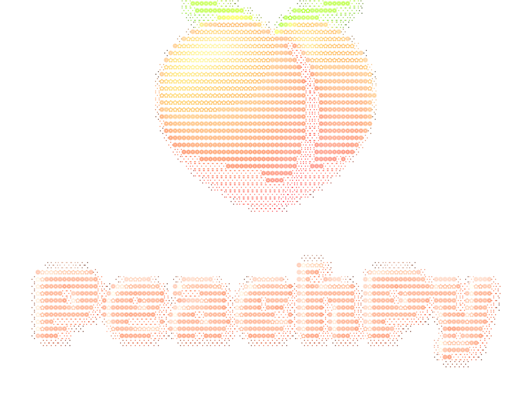
</picture>

</div>

[Python 3.10+](https://www.python.org/downloads/) • [License: MIT](LICENSE) • [Pillow](https://python-pillow.org)

_Turn any image into text • Terminal, HTML or SVG • Gradients, rainbows and any glyph ramp you like_

**A small Python CLI that turns images into ASCII art.** Point it at a photo, painting or logo and get plain text, truecolor terminal output, a self-contained HTML page, or a scalable SVG you can drop straight into a README. The hero above was made with it.

**Try it in one line** (needs [uv](#prerequisite-uv)):

```bash
uvx --from git+https://github.com/interfaceconjurer/ascii-image-generator ascii-art path/to/image.jpg
```

&nbsp;

## Table of Contents

- [How It Works](#how-it-works)
- [Gallery](#gallery)
  - [Old Masters in Light](#old-masters-in-light)
  - [Space](#space)
  - [Iconic Photography](#iconic-photography)
- [Install](#install)
  - [Prerequisite: uv](#prerequisite-uv)
  - [Try It Without Installing](#try-it-without-installing)
  - [Install the `ascii-art` Command](#install-the-ascii-art-command)
  - [Notes for Scripts and AI Agents](#notes-for-scripts-and-ai-agents)
- [Usage](#usage)
  - [Output Modes](#output-modes)
  - [Character Ramps](#character-ramps)
  - [Color: Gradients and Rainbow](#color-gradients-and-rainbow)
  - [Density](#density)
- [Options](#options)
- [Python API](#python-api)
- [Tips and Known Quirks](#tips-and-known-quirks)
- [Development](#development)
- [Credits](#credits)
- [License](#license)

&nbsp;

## How It Works

```text
image ─▶ resize ─▶ grayscale ─▶ glyph ramp ─▶ color ─▶ text · ANSI · HTML · SVG
```

1. **Resize.** The image is scaled to `--width` columns. Rows are squashed to match the
   shape of a character cell, so circles stay circles: 0.55 for terminals and 1/1.6 for SVG.
2. **Grayscale.** Each cell's brightness (0–255) is computed.
3. **Glyph ramp.** Brightness picks a character from `--chars`, ordered dark → light.
   The ramp can be anything: ASCII, Unicode dots, block shading, emoji.
4. **Color.** Each glyph keeps its source pixel's color, or is recolored by a diagonal
   `--gradient` or a horizontal `--rainbow`. Both are modulated by the image's brightness
   so the shape still reads.
5. **Render.** The result is written as plain text, ANSI truecolor or 256-color, an HTML
   `<pre>`, or an SVG of positioned `<text>` glyphs.

```bash
# One command, end to end
ascii-art photo.jpg -m svg -w 110 -c " ·∘○◯●" -o photo.svg
```

&nbsp;

&nbsp;

## Gallery

Every piece below is a single command. Tap an image, or open **Commands** under each section, to copy it.

### Old Masters in Light

Circles grow with brightness, so the painting's light falls in rings of `· ∘ ○ ◯ ●`.

<!-- GALLERY:old-masters -->
<p align="left"><a href="#pearl-earring">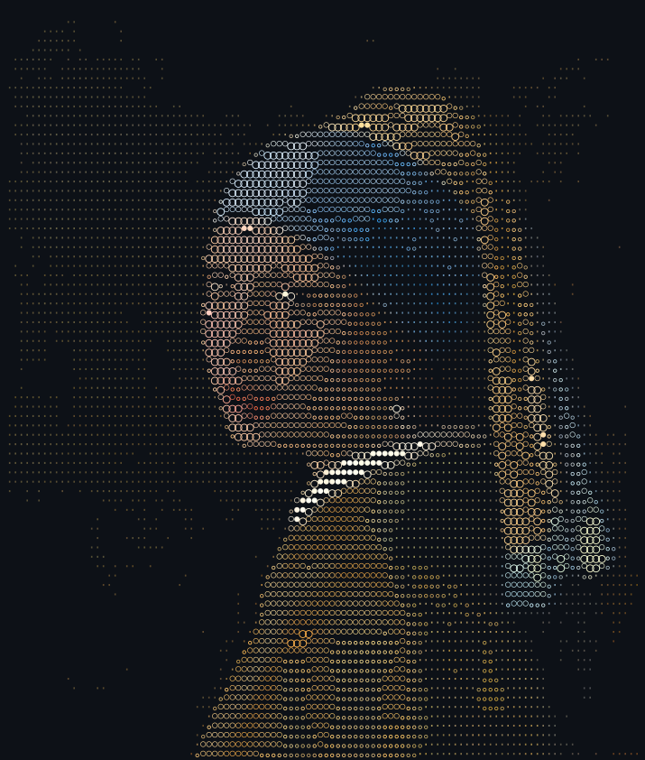</a><a href="#virgin-annunciate">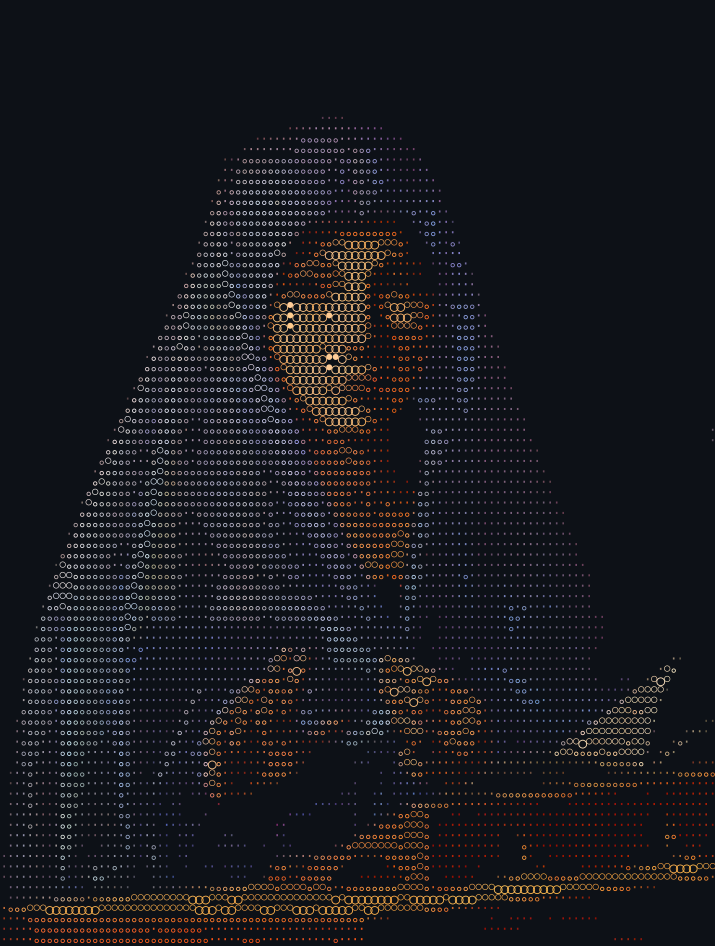</a><br><a href="#rembrandt-self-portrait">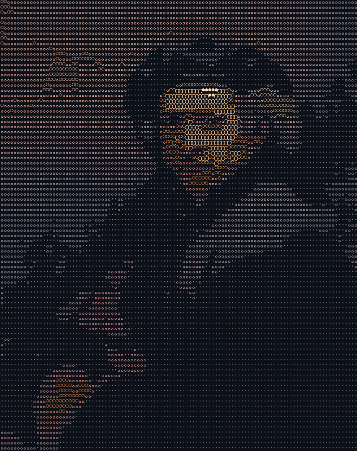</a><a href="#magdalene-smoking-flame">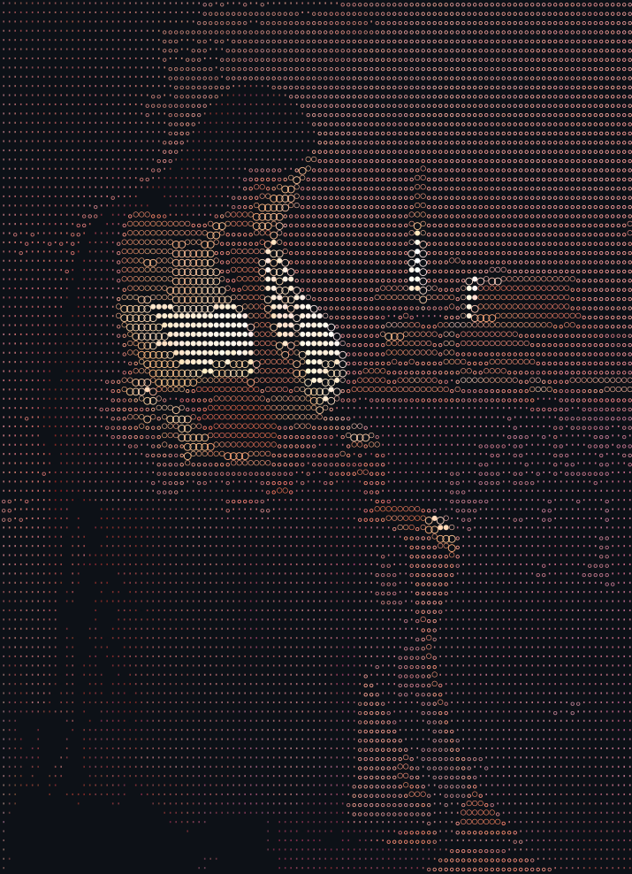</a><a href="#mona-lisa">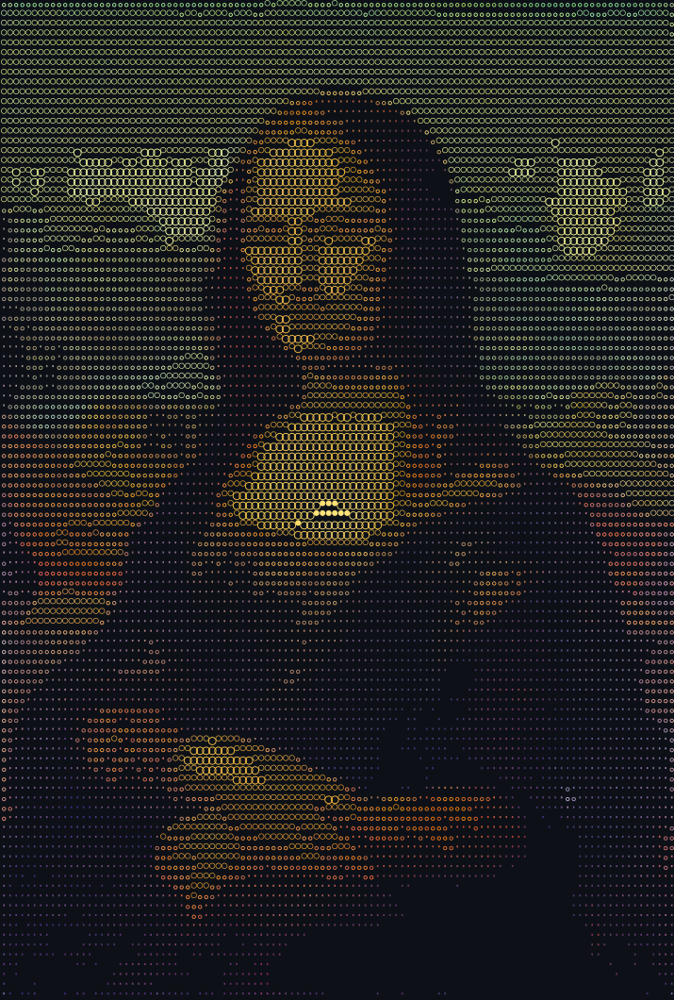</a><br><a href="#lady-with-an-ermine">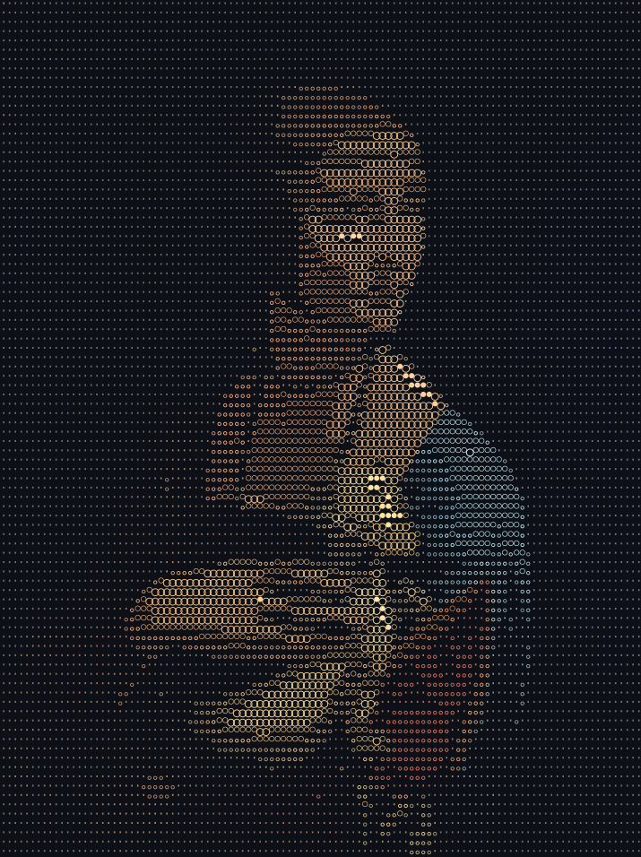</a><a href="#man-in-a-red-turban">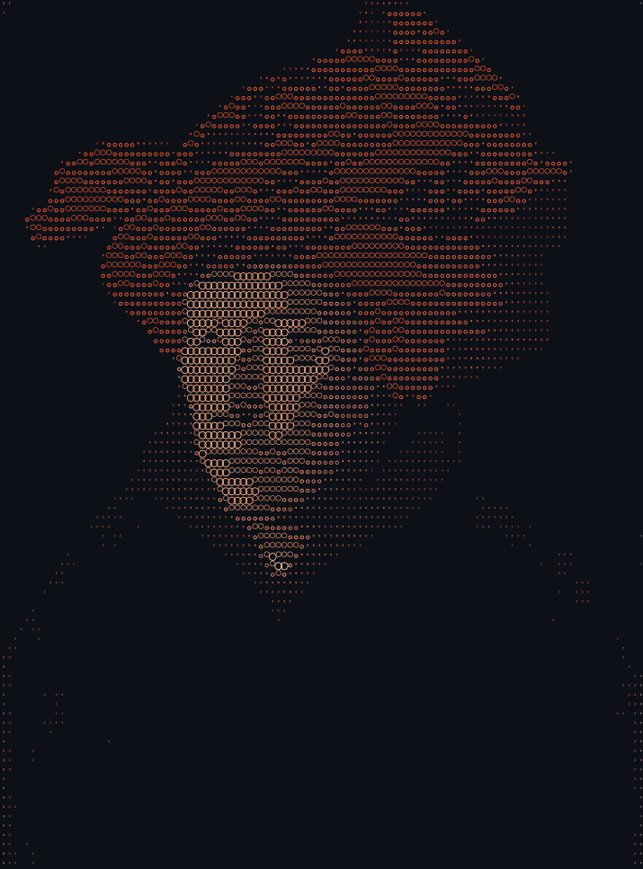</a><a href="#david-goliath">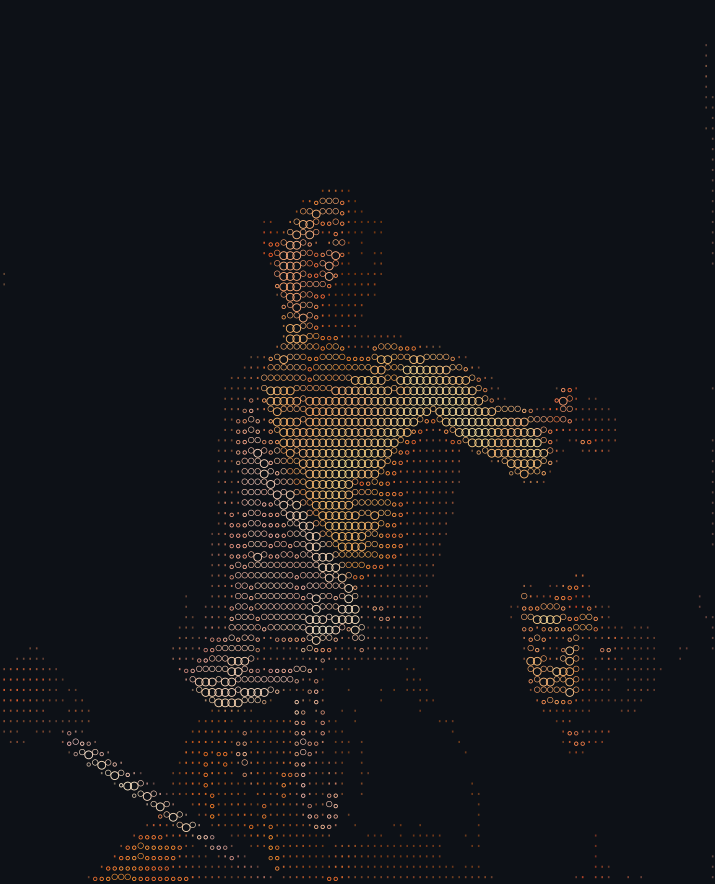</a><br><a href="#great-wave">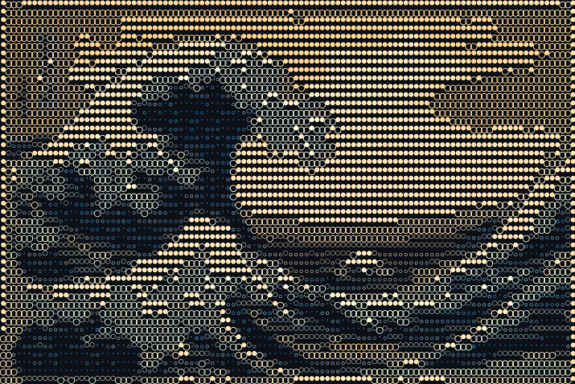</a><a href="#starry-night">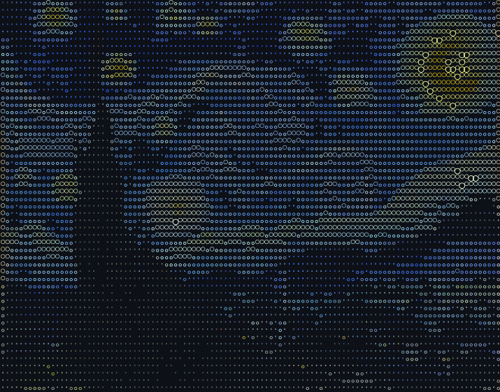</a><a href="#medusa">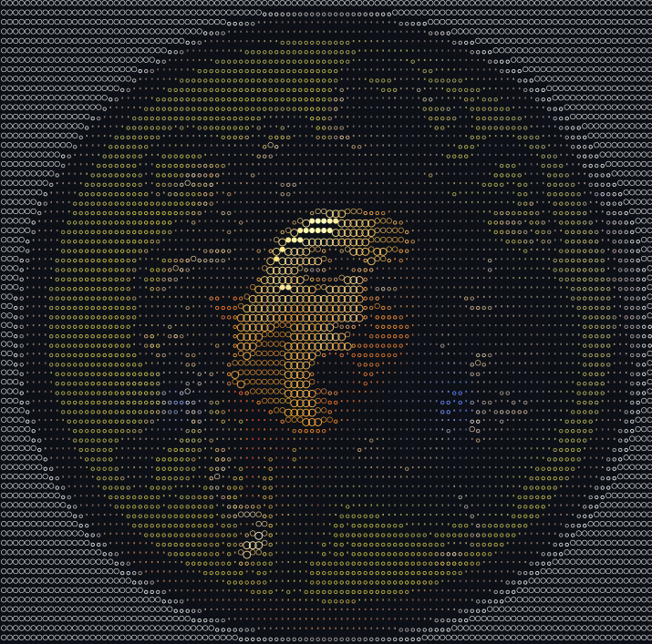</a></p>

<details><summary>Commands for this section</summary>

<a id="pearl-earring"></a>**Girl with a Pearl Earring** · Johannes Vermeer, c. 1665

```bash
ascii-art pearl-earring.jpg -m svg -w 110 --pixel-width 715 -c " ·∘○◯●" -s 1.4 -b 1.9 -o pearl-earring.svg
```

<a id="virgin-annunciate"></a>**Virgin Annunciate** · Antonello da Messina, c. 1475

```bash
ascii-art virgin-annunciate.jpg -m svg -w 110 --pixel-width 715 -c " ·∘○◯●" -s 1.4 -b 1.9 -o virgin-annunciate.svg
```

<sub>Prep: auto-level, -level 10%,100%, gamma 1.3</sub>

<a id="rembrandt-self-portrait"></a>**Self-Portrait** · Rembrandt, 1659

```bash
ascii-art rembrandt-self-portrait.jpg -m svg -w 110 --pixel-width 715 -c " ·∘○◯●" -s 1.4 -b 1.9 -o rembrandt-self-portrait.svg
```

<sub>Prep: auto-level, gamma 1.2</sub>

<a id="magdalene-smoking-flame"></a>**Magdalene with the Smoking Flame** · Georges de La Tour, c. 1640

```bash
ascii-art magdalene-smoking-flame.jpg -m svg -w 110 --pixel-width 715 -c " ·∘○◯●" -s 1.4 -b 1.9 -o magdalene-smoking-flame.svg
```

<sub>Prep: auto-level, gamma 1.5</sub>

<a id="mona-lisa"></a>**Mona Lisa** · Leonardo da Vinci, c. 1503–1519

```bash
ascii-art mona-lisa.jpg -m svg -w 110 --pixel-width 715 -c " ·∘○◯●" -s 1.4 -b 1.9 -o mona-lisa.svg
```

<sub>Prep: auto-level, gamma 1.3</sub>

<a id="lady-with-an-ermine"></a>**Lady with an Ermine** · Leonardo da Vinci, c. 1490

```bash
ascii-art lady-with-an-ermine.jpg -m svg -w 110 --pixel-width 715 -c " ·∘○◯●" -s 1.4 -b 1.9 -o lady-with-an-ermine.svg
```

<sub>Prep: auto-level, gamma 1.2</sub>

<a id="man-in-a-red-turban"></a>**Portrait of a Man (Self-Portrait?)** · Jan van Eyck, 1433

```bash
ascii-art man-in-a-red-turban.jpg -m svg -w 110 --pixel-width 715 -c " ·∘○◯●" -s 1.4 -b 1.9 -o man-in-a-red-turban.svg
```

<sub>Prep: auto-level, gamma 1.2</sub>

<a id="david-goliath"></a>**David with the Head of Goliath** · Caravaggio, 1610

```bash
ascii-art david-goliath.jpg -m svg -w 110 --pixel-width 715 -c " ·∘○◯●" -s 1.4 -b 1.9 -o david-goliath.svg
```

<a id="great-wave"></a>**The Great Wave off Kanagawa** · Katsushika Hokusai, c. 1831

```bash
ascii-art great-wave.jpg -m svg -w 110 --pixel-width 715 -c " ·∘○◯●" -s 1.6 -b 1.2 -o great-wave.svg
```

<a id="starry-night"></a>**The Starry Night** · Vincent van Gogh, 1889

```bash
ascii-art starry-night.jpg -m svg -w 110 --pixel-width 715 -c " ·∘○◯●" -s 1.4 -b 1.9 -o starry-night.svg
```

<a id="medusa"></a>**Medusa** · Caravaggio, c. 1597

```bash
ascii-art medusa.jpg -m svg -w 110 --pixel-width 715 -c " ·∘○◯●" -s 1.4 -b 1.9 -o medusa.svg
```

<sub>Prep: auto-level, gamma 1.2</sub>

</details>
<!-- /GALLERY:old-masters -->

### Space

NASA and ESA imagery. Where it fits, the ramp matches the subject: Saturn in rings, the Moon in moon phases, Jupiter in bands.

<!-- GALLERY:space -->
<p align="left"><a href="#whirlpool-galaxy">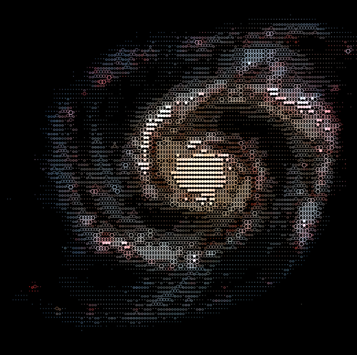</a><a href="#ring-nebula">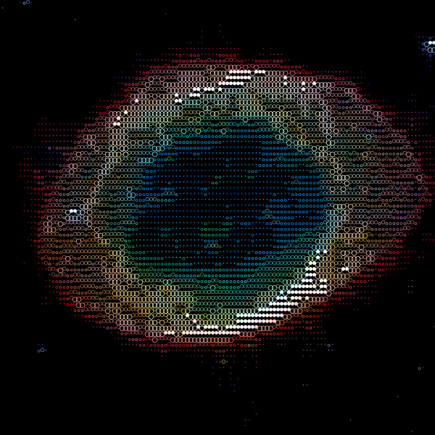</a><br><a href="#saturn">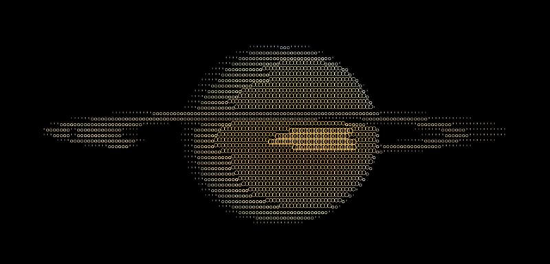</a><a href="#moon">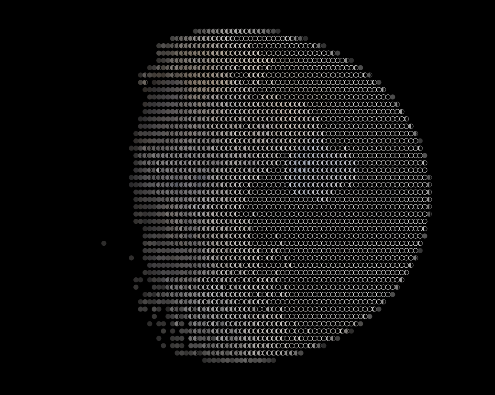</a><a href="#pleiades">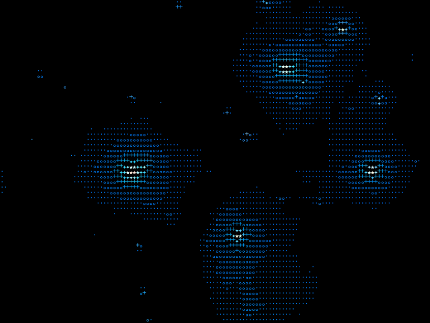</a><br><a href="#jupiter">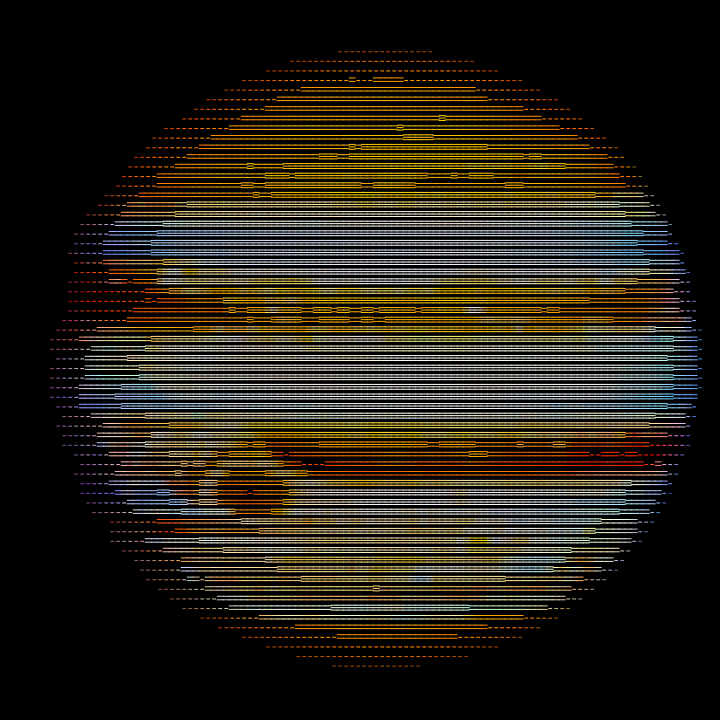</a><a href="#sun">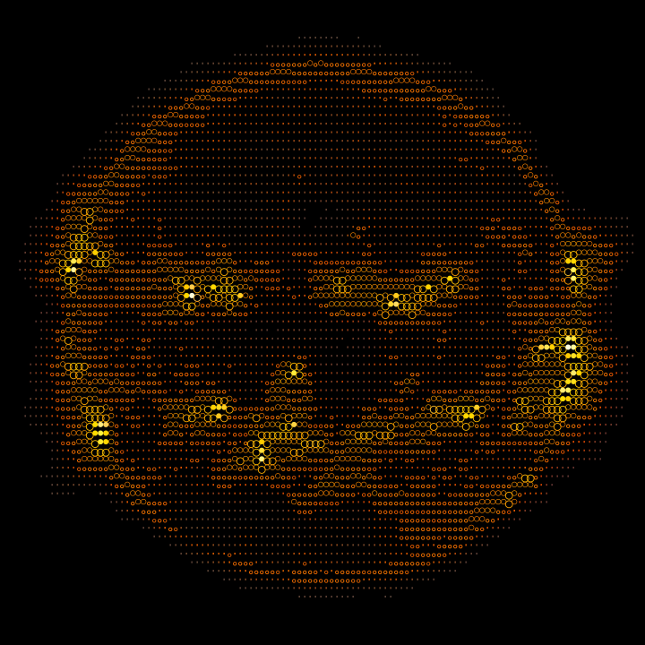</a><a href="#blue-marble">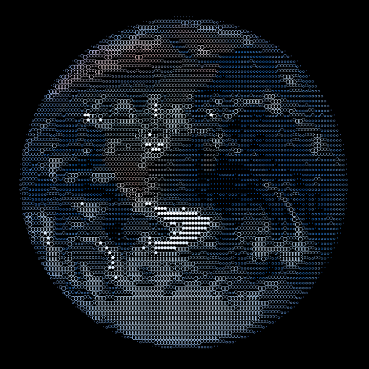</a><br><a href="#helix-nebula">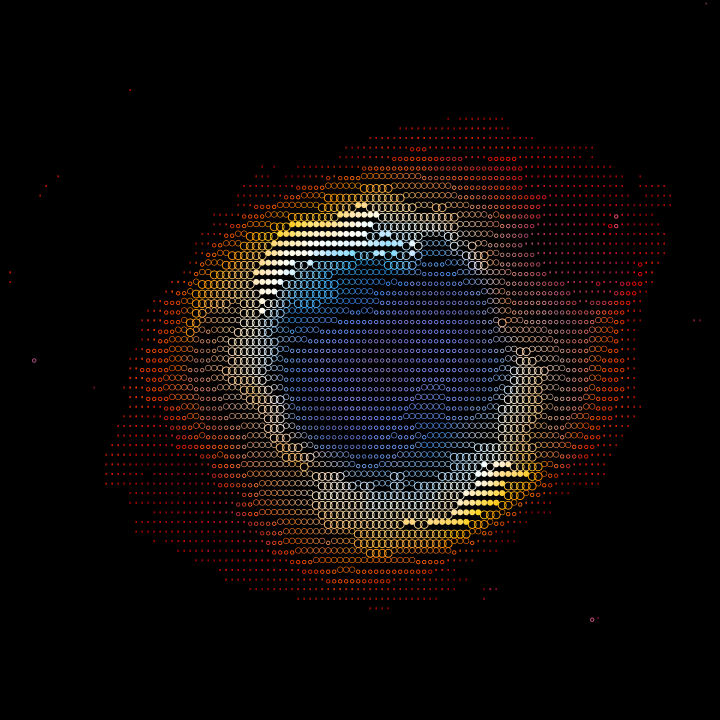</a><a href="#m87">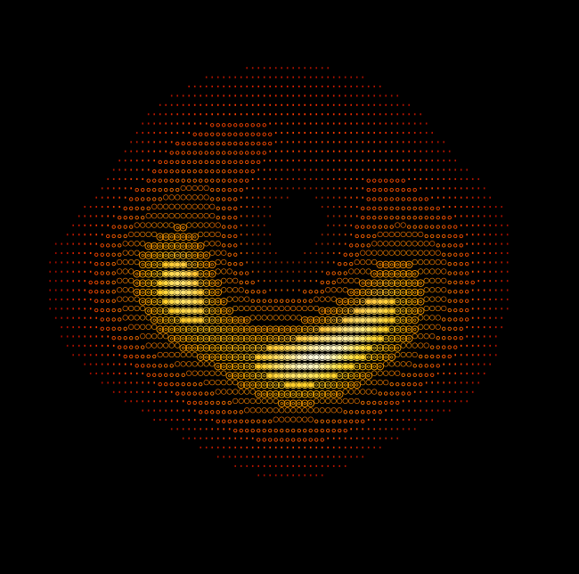</a><a href="#pluto">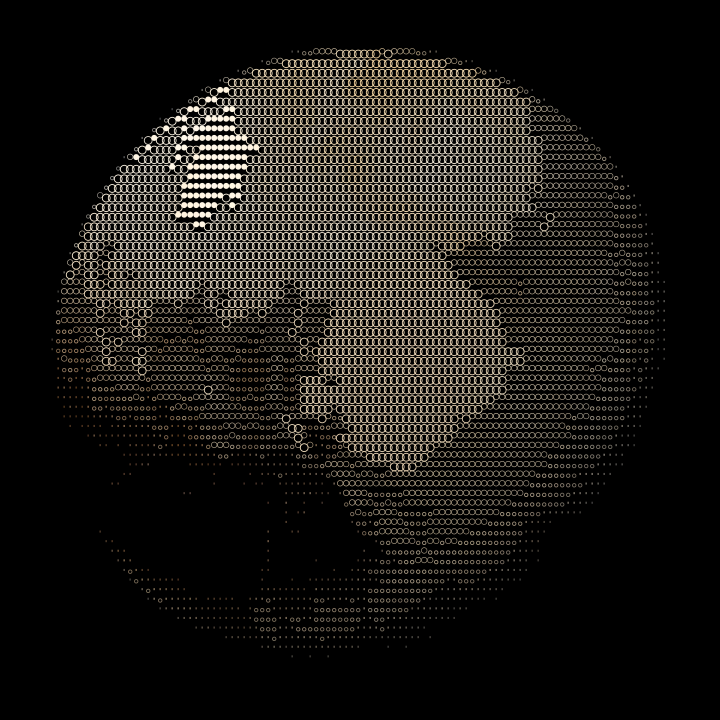</a></p>

<details><summary>Commands for this section</summary>

<a id="whirlpool-galaxy"></a>**Whirlpool Galaxy (M51)** · NASA, ESA, S. Beckwith (STScI), Hubble Heritage Team

```bash
ascii-art whirlpool-galaxy.jpg -m svg -w 130 --pixel-width 715 -c " ·∘○◯●" -s 1.6 -b 1.4 -o whirlpool-galaxy.svg
```

<sub>Prep: -level 12%,100% -clahe 25x25%+128+3 -sigmoidal-contrast 4x45%</sub>

<a id="ring-nebula"></a>**Ring Nebula (M57), JWST** · NASA, ESA, CSA, M. Barlow, N. Cox, R. Wesson

```bash
ascii-art ring-nebula.jpg -m svg -w 120 --pixel-width 720 -c " ·∘○◯●" -s 1.5 -b 1.5 -o ring-nebula.svg
```

<sub>Prep: center crop, -level 8%,100% -sigmoidal-contrast 4x40%</sub>

<a id="saturn"></a>**Saturn in rings** · NASA/JPL/Space Science Institute (Cassini), 2008

```bash
ascii-art saturn.jpg -m svg -w 160 --pixel-width 800 -c " ·∘○◯" -s 1.4 -b 1.5 -o saturn.svg
```

<a id="moon"></a>**The Moon, in moon phases** · Rendered from NASA SVS CGI Moon Kit (LRO color + LOLA elevation)

```bash
ascii-art moon.jpg -m svg -w 108 --pixel-width 1188 -c " 🌑🌒🌓🌔🌕" -o moon.svg
```

<sub>Prep: CGI lit sphere; 1.19× wide for emoji</sub>

<a id="pleiades"></a>**The Pleiades, in stars** · NASA, ESA, AURA/Caltech, Palomar Observatory

```bash
ascii-art pleiades.jpg -m svg -w 130 --pixel-width 845 -c "  ·∘+✦★" -s 1.7 -b 2.0 -o pleiades.svg
```

<sub>Prep: crop, -level 10%,100%, gamma 1.3</sub>

<a id="jupiter"></a>**Jupiter, in cloud bands** · NASA, ESA, A. Simon (GSFC), OPAL, 2024

```bash
ascii-art jupiter.jpg -m svg -w 120 --pixel-width 720 -c " -=≡" -s 1.8 -b 1.6 -o jupiter.svg
```

<sub>Prep: -modulate 100,220 -sigmoidal-contrast 7x50%</sub>

<a id="sun"></a>**The Sun, SDO/AIA** · NASA/GSFC/SDO, Oct 2014

```bash
ascii-art sun.jpg -m svg -w 120 --pixel-width 720 -c " ·∘○◯●" -s 1.5 -b 1.8 -o sun.svg
```

<sub>Prep: auto-level, gamma 2.2</sub>

<a id="blue-marble"></a>**The Blue Marble** · NASA / Apollo 17 crew, 1972

```bash
ascii-art blue-marble.jpg -m svg -w 120 --pixel-width 720 -c " ·∘○◯●" -s 1.5 -b 1.4 -o blue-marble.svg
```

<sub>Prep: -sigmoidal-contrast 3x50%</sub>

<a id="helix-nebula"></a>**Helix Nebula (NGC 7293)** · NASA, ESA, C.R. O'Dell (Vanderbilt)

```bash
ascii-art helix-nebula.jpg -m svg -w 120 --pixel-width 720 -c " ·∘○◯●" -s 1.5 -b 1.5 -o helix-nebula.svg
```

<sub>Prep: center crop, -level 8%,100% -sigmoidal-contrast 4x40%</sub>

<a id="m87"></a>**M87* black hole, in rings** · Event Horizon Telescope Collaboration, 2019

```bash
ascii-art m87.jpg -m svg -w 100 --pixel-width 650 -c " ·∘○◎◉" -s 1.3 -b 1.5 -o m87.svg
```

<sub>Prep: center crop, gamma 1.2</sub>

<a id="pluto"></a>**Pluto** · NASA/JHUAPL/SwRI (New Horizons), 2015

```bash
ascii-art pluto.jpg -m svg -w 120 --pixel-width 720 -c " ·∘○◯●" -s 1.4 -b 1.3 -o pluto.svg
```

<sub>Prep: -sigmoidal-contrast 4x55% -level 8%,100%, gamma 0.9</sub>

</details>
<!-- /GALLERY:space -->

### Iconic Photography

Halftone dots in a single ink, `-c " ·•●" --gradient "#F2E8D5,#F2E8D5"`, plus pop-art color variants.

<!-- GALLERY:photography -->
<p align="left"><a href="#marilyn-pop-a">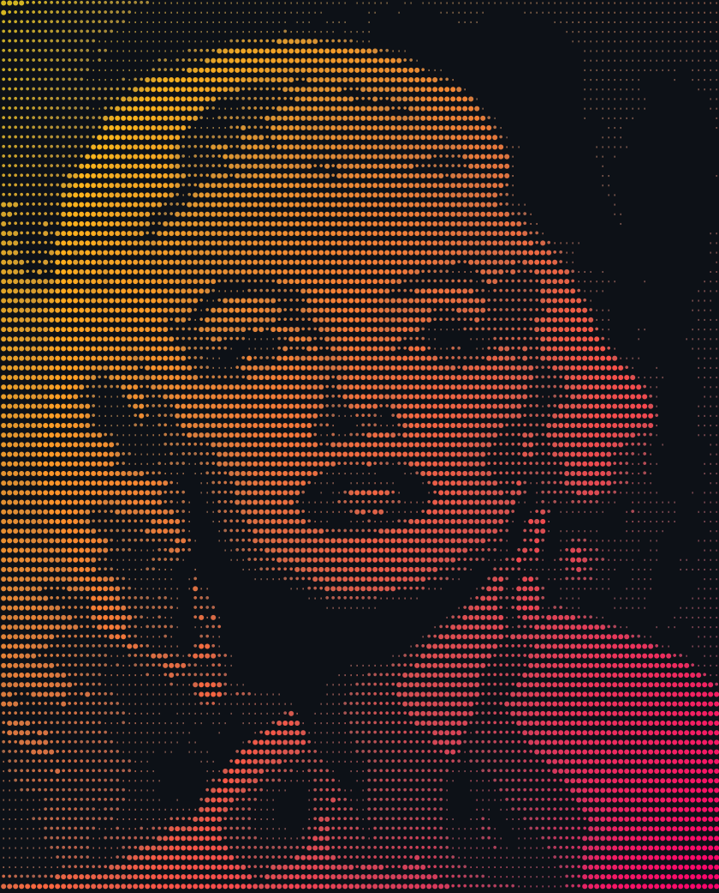</a><a href="#migrant-mother">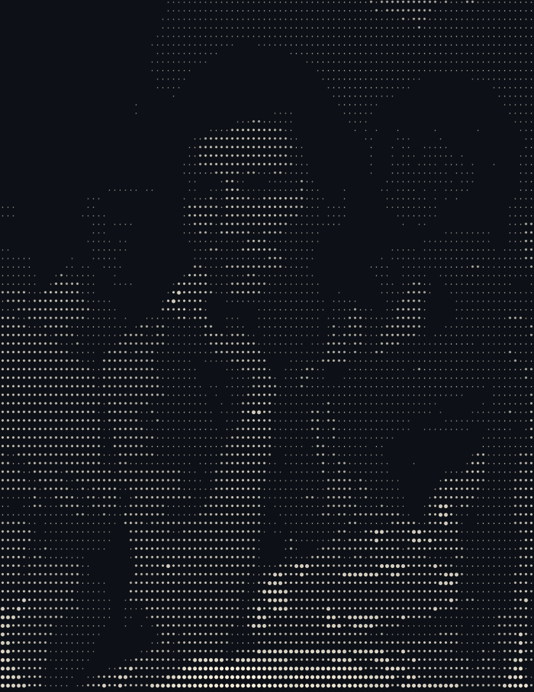</a><br><a href="#abraham-lincoln">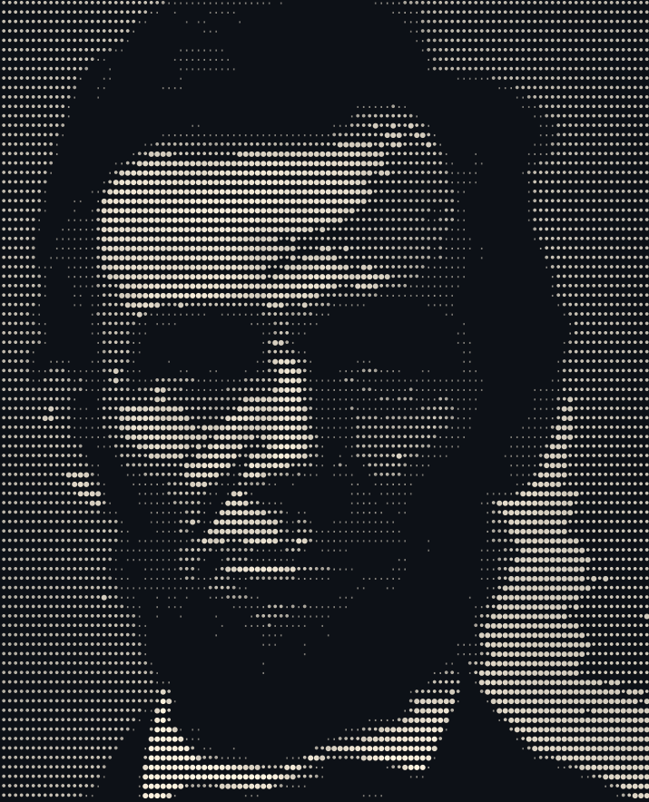</a><a href="#billie-holiday">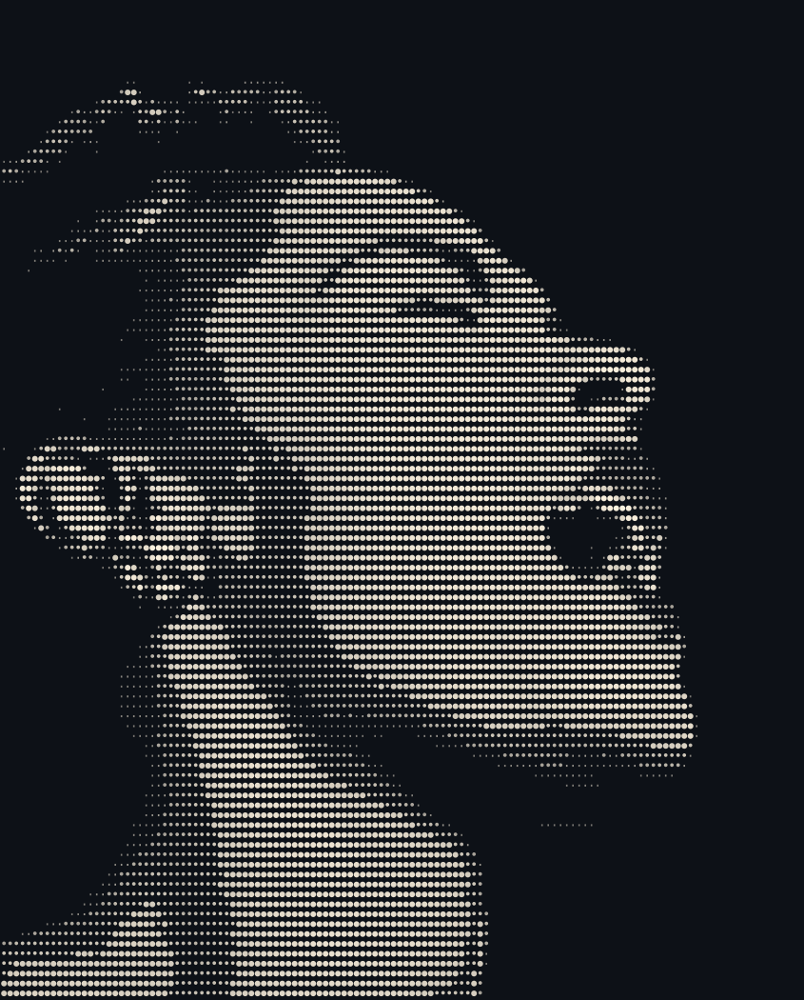</a><a href="#audrey-hepburn">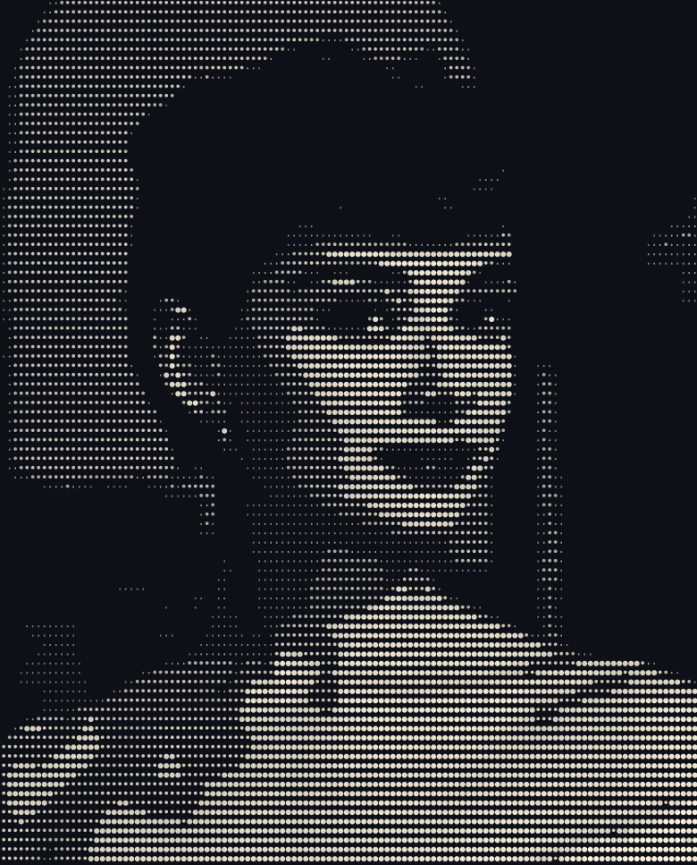</a><br><a href="#einstein-pop">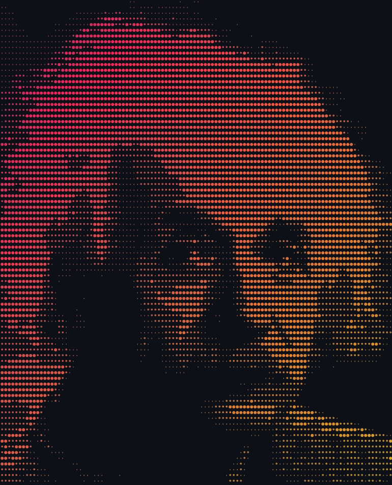</a><a href="#muhammad-ali">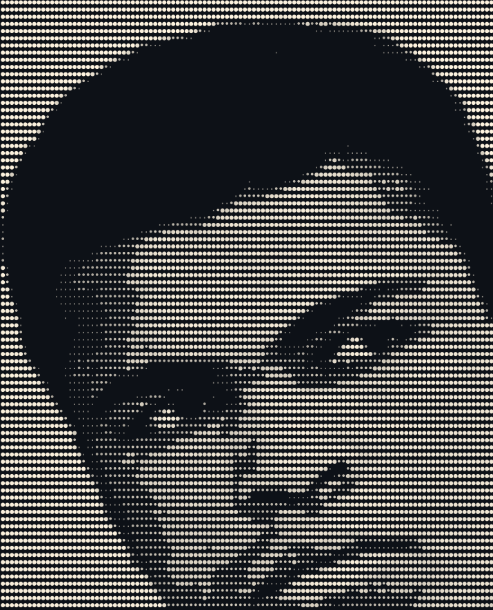</a><a href="#greta-garbo">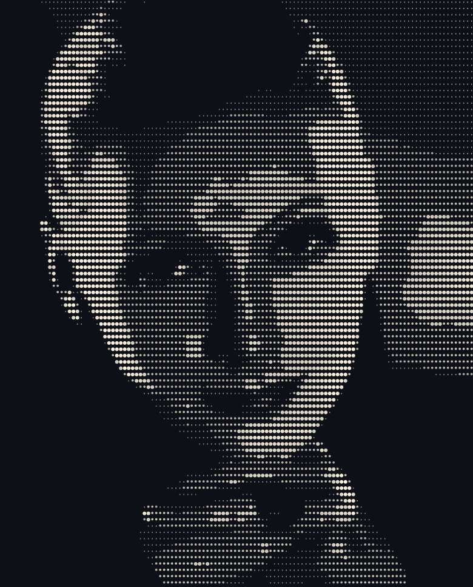</a><br><a href="#nikola-tesla">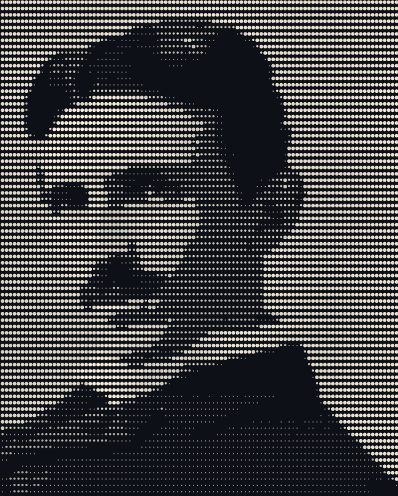</a><a href="#frida-kahlo">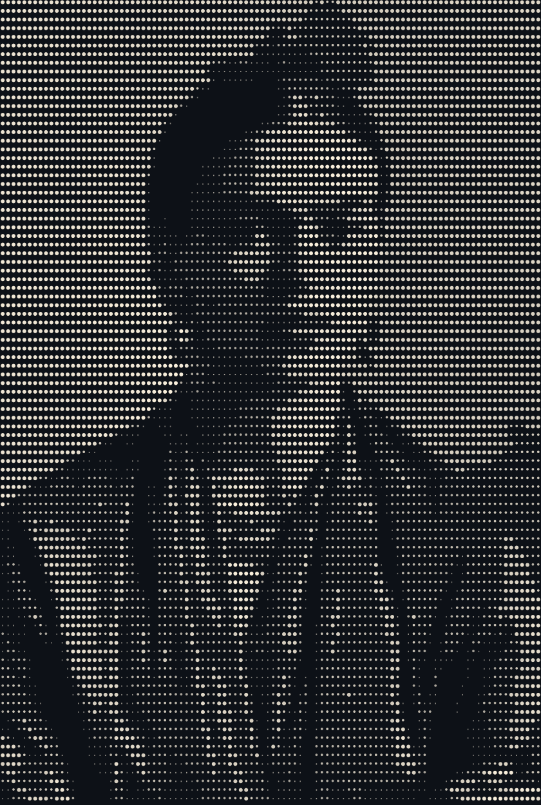</a><a href="#baldwin-iv">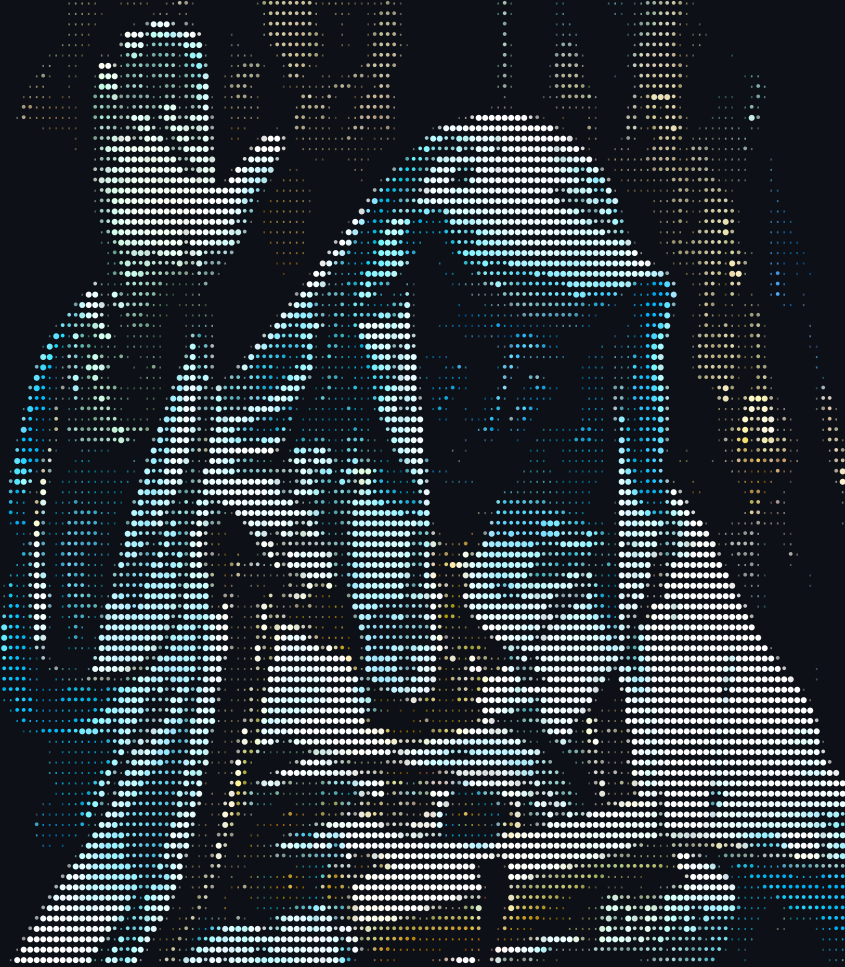</a></p>

<details><summary>Commands for this section</summary>

<a id="marilyn-pop-a"></a>**Marilyn, pop (yellow → magenta)** · Frank Powolny, 1953

```bash
ascii-art marilyn-pop-a.jpg -m svg -w 120 --pixel-width 840 -c " ·•●" --gradient "#FFD60A,#FF006E" -o marilyn-pop-a.svg
```

<sub>Prep: auto-level, gamma 1.15</sub>

<a id="migrant-mother"></a>**Migrant Mother** · Dorothea Lange, 1936

```bash
ascii-art migrant-mother.jpg -m svg -w 100 --pixel-width 840 -c " ·•●" --gradient "#F2E8D5,#F2E8D5" -o migrant-mother.svg
```

<a id="abraham-lincoln"></a>**Abraham Lincoln** · Alexander Gardner, 1863

```bash
ascii-art abraham-lincoln.jpg -m svg -w 110 --pixel-width 715 -c " ·•●" --gradient "#F2E8D5,#F2E8D5" -o abraham-lincoln.svg
```

<sub>Prep: crop, -level 10%,100% -gamma 1.2 -sigmoidal-contrast 3x45%</sub>

<a id="billie-holiday"></a>**Billie Holiday** · William P. Gottlieb, c. 1947

```bash
ascii-art billie-holiday.jpg -m svg -w 130 --pixel-width 845 -c " ·•●" --gradient "#F2E8D5,#F2E8D5" -o billie-holiday.svg
```

<sub>Prep: crop</sub>

<a id="audrey-hepburn"></a>**Audrey Hepburn** · Bud Fraker (Paramount), 1953

```bash
ascii-art audrey-hepburn.jpg -m svg -w 120 --pixel-width 780 -c " ·•●" --gradient "#F2E8D5,#F2E8D5" -o audrey-hepburn.svg
```

<sub>Prep: crop, -level 20%,100% -gamma 1.8 -sigmoidal-contrast 3x40%</sub>

<a id="einstein-pop"></a>**Einstein, pop (magenta → amber)** · Orren Jack Turner, 1947

```bash
ascii-art einstein-pop.jpg -m svg -w 110 --pixel-width 770 -c " ·•●" --gradient "#FF006E,#FFBE0B" -o einstein-pop.svg
```

<sub>Prep: same prep as Einstein</sub>

<a id="muhammad-ali"></a>**Muhammad Ali** · Ira Rosenberg (NYWTS), 1967

```bash
ascii-art muhammad-ali.jpg -m svg -w 110 --pixel-width 715 -c " ·•●" --gradient "#F2E8D5,#F2E8D5" -o muhammad-ali.svg
```

<sub>Prep: crop, -sigmoidal-contrast 3x50%</sub>

<a id="greta-garbo"></a>**Greta Garbo** · Clarence Sinclair Bull, 1931

```bash
ascii-art greta-garbo.jpg -m svg -w 120 --pixel-width 780 -c " ·•●" --gradient "#F2E8D5,#F2E8D5" -o greta-garbo.svg
```

<sub>Prep: crop, -level 15%,100%</sub>

<a id="nikola-tesla"></a>**Nikola Tesla** · Napoleon Sarony, c. 1890

```bash
ascii-art nikola-tesla.jpg -m svg -w 100 --pixel-width 650 -c " ·•●" --gradient "#F2E8D5,#F2E8D5" -o nikola-tesla.svg
```

<sub>Prep: crop</sub>

<a id="frida-kahlo"></a>**Frida Kahlo** · Guillermo Kahlo, 1932

```bash
ascii-art frida-kahlo.jpg -m svg -w 100 --pixel-width 840 -c " ·•●" --gradient "#F2E8D5,#F2E8D5" -o frida-kahlo.svg
```

<sub>Prep: auto-level, gamma 1.4, -sigmoidal-contrast 4x50%</sub>

<a id="baldwin-iv"></a>**Baldwin IV, the Leper King** · Film still, Kingdom of Heaven (2005)

```bash
ascii-art baldwin-iv.jpg -m svg -w 130 --pixel-width 845 -c " ·•●" -s 1.4 -b 1.15 -o baldwin-iv.svg
```

<sub>Prep: crop to figure, -clahe 12x12%+128+3 -level 10%,100%</sub>

</details>
<!-- /GALLERY:photography -->

&nbsp;

&nbsp;

## Install

### Prerequisite: uv

[uv](https://docs.astral.sh/uv/) is a fast Python package and tool manager. It also
downloads Python 3.10+ automatically if it's missing, so you don't need Python first.

Check whether you have it:

```bash
uv --version
```

If that fails, install uv with **one** of these:

```bash
# macOS / Linux
curl -LsSf https://astral.sh/uv/install.sh | sh
```

```bash
# macOS with Homebrew
brew install uv
```

```powershell
# Windows (PowerShell)
powershell -ExecutionPolicy ByPass -c "irm https://astral.sh/uv/install.ps1 | iex"
```

Then open a new terminal so `uv` is on your PATH. For other options, see the
[uv installation docs](https://docs.astral.sh/uv/getting-started/installation/).

### Try It Without Installing

```bash
uvx --from git+https://github.com/interfaceconjurer/ascii-image-generator ascii-art path/to/image.jpg
```

uv builds a cached, throwaway environment and runs the tool. Nothing stays installed.

### Install the `ascii-art` Command

```bash
uv tool install git+https://github.com/interfaceconjurer/ascii-image-generator
```

Verify:

```bash
ascii-art --help
```

If you get `command not found`, run `uv tool update-shell` and open a new terminal.

Upgrade with `uv tool upgrade ascii-art`. Uninstall with `uv tool uninstall ascii-art`.

<details>
<summary>Without uv (pipx or pip)</summary>

```bash
pipx install git+https://github.com/interfaceconjurer/ascii-image-generator
```

```bash
pip install git+https://github.com/interfaceconjurer/ascii-image-generator
```

These need Python 3.10+ already installed.

</details>

### Notes for Scripts and AI Agents

- **Command:** `ascii-art <image> [options]`. `python -m ascii_art` is equivalent.
- **Inputs:** any image Pillow can open (JPEG, PNG, GIF, WebP, …).
- **Output location:**
  - `-m color` (default) and `-m plain` print to stdout, or write to `-o FILE`.
  - `-m html` and `-m svg` always write a file: `-o FILE`, or `./ascii_art.html` /
    `./ascii_art.svg` in the current directory, overwriting any existing file. They print
    `Saved HTML to <path>` / `Saved SVG to <path>`.
- **Color when piped:** `--color-mode auto` (default) drops ANSI escapes when stdout isn't a
  terminal, so piped or redirected output is clean text.
- **Exit codes:** `0` success · `1` input file not found or invalid `--gradient` · `2` invalid arguments.
- **Full options:** `ascii-art --help` or the [Options](#options) table.
- **Working on the code?** See [Development](#development) and [AGENTS.md](AGENTS.md).

&nbsp;

&nbsp;

## Usage

### Output Modes

```bash
# Colored terminal output (default; auto-detects truecolor / 256-color)
ascii-art image.jpg

# Plain text
ascii-art image.jpg -m plain -w 80

# Self-contained HTML page
ascii-art image.jpg -m html -o art.html

# Scalable SVG, 1200px wide
ascii-art image.jpg -m svg --pixel-width 1200 -o art.svg
```

When stdout isn't a terminal, color mode falls back to plain text. Use
`--color-mode truecolor` to force escapes, for example `ascii-art image.jpg --color-mode truecolor > art.ans`.

### Character Ramps

`--chars` is ordered **dark → light**. The default ramp is `"B S#&@$%*!:. "`. Ramps that
read well:

| Ramp                 | Look                         |
| -------------------- | ---------------------------- |
| `" .:-=+*#%@"`       | Classic ASCII                |
| `" ·∘○◯●"`           | Circles that grow with light |
| `" ·•●"`             | Halftone dots                |
| `" ░▒▓█"`            | Block shading                |
| `" ·+✦★"`            | Stars                        |
| `" 🌑🌒🌓🌔🌕"`       | Moon phases                  |

```bash
ascii-art image.jpg -m svg -c " ░▒▓█" -o blocks.svg
ascii-art image.jpg --invert -c " ·•●"
```

### Color: Gradients and Rainbow

```bash
# Diagonal gradient, top-left → bottom-right, 2 or more 6-digit hex stops
ascii-art image.jpg -m svg --gradient "#3D1A4D,#9B59B6,#FFD700,#B8860B" -o gold.svg

# A single-ink look: use the same color twice
ascii-art image.jpg -m svg -c " ·•●" --gradient "#F2E8D5,#F2E8D5" -o ink.svg

# Horizontal rainbow, brighter
ascii-art image.jpg -m svg --rainbow -b 1.5 -o rainbow.svg

# Punchier source colors
ascii-art image.jpg -m svg -s 1.6 -b 1.3 -o vivid.svg
```

### Density

In SVG mode, glyphs are always drawn at 14px and `--pixel-width` only sets the spacing
between them. A large `--pixel-width` gives airy, separate glyphs. At around 6–8 px per
column the glyphs overlap and fuse into texture, and many of the gallery pieces rely on
exactly that.

```bash
ascii-art image.jpg -m svg -w 110 -c " ·∘○◯●" --pixel-width 1500 -o airy.svg
ascii-art image.jpg -m svg -w 110 -c " ·∘○◯●" --pixel-width 715  -o dense.svg
```

&nbsp;

&nbsp;

## Options

| Flag               | Default         | Description                                                    |
| ------------------ | --------------- | -------------------------------------------------------------- |
| `-w, --width`      | `120`           | Output width in characters                                     |
| `-m, --mode`       | `color`         | `plain`, `color`, `html` or `svg`                              |
| `-c, --chars`      | `B S#&@$%*!:. ` | Character ramp, dark → light                                   |
| `-s, --saturation` | `1.0`           | Saturation multiplier (color, HTML, SVG)                       |
| `-b, --brightness` | `1.0`           | Brightness multiplier (color, HTML, SVG)                       |
| `--pixel-width`    | –               | Output width in pixels (HTML, SVG). See [Density](#density)    |
| `--invert`         | off             | Invert brightness: dark areas get the light glyphs             |
| `--rainbow`        | off             | Recolor with a horizontal rainbow                              |
| `--gradient`       | –               | Recolor with a diagonal gradient, e.g. `"#FF0000,#0000FF"`     |
| `--color-mode`     | `auto`          | `auto`, `truecolor`, `256` or `none`                           |
| `-o, --output`     | stdout          | Output file (HTML and SVG default to `ascii_art.html` / `.svg`) |

&nbsp;

&nbsp;

## Python API

```python
from ascii_art import image_to_ascii, get_color_data

# Plain text
print(image_to_ascii("photo.jpg", width=100))

# Per-character color data, for your own renderer
rows = get_color_data("photo.jpg", width=100, chars=" ·•●", rainbow=True)
for row in rows:
    for char, (r, g, b) in row:
        ...

# Gradient stops as RGB tuples
rows = get_color_data("photo.jpg", width=100, gradient=[(61, 26, 77), (255, 215, 0)])
```

&nbsp;

&nbsp;

## Tips and Known Quirks

- **Pick sources with strong shapes.** Silhouettes, hard light and a wide tonal range
  read best. Busy mid-gray images turn to mush.
- **The default ramp has a space in second place**, which punches holes in dark areas.
  For photos, try one of the [ramps above](#character-ramps).
- **Transparent PNG areas render black.** Flatten onto a background first if you need white.
- **`-s` and `-b` don't affect `plain` mode**, which has no color.
- **Ramps can be any length.** Ramps longer than 256 characters are spread evenly across the gray levels.

&nbsp;

&nbsp;

## Development

```bash
git clone https://github.com/interfaceconjurer/ascii-image-generator.git
cd ascii-image-generator
uv venv && uv pip install -e ".[dev]"
source .venv/bin/activate
pytest
ruff check .
```

&nbsp;

&nbsp;

## Credits

<!-- CREDITS -->

**Gallery sources.** Renders are by this tool. Sources are public domain or CC0 unless noted.

<details><summary>All gallery credits</summary>

| Piece | Creator | Source | License |
|---|---|---|---|
| Girl with a Pearl Earring | Johannes Vermeer, c. 1665 | [source](https://commons.wikimedia.org/wiki/File:1665_Girl_with_a_Pearl_Earring.jpg) | Public domain |
| Lady with an Ermine | Leonardo da Vinci, c. 1490 | [source](https://commons.wikimedia.org/wiki/File:Lady_with_an_Ermine_-_Leonardo_da_Vinci_-_Google_Art_Project.jpg) | Public domain |
| Portrait of a Man (Self-Portrait?) | Jan van Eyck, 1433 | [source](https://commons.wikimedia.org/wiki/File:Portrait_of_a_Man_in_a_Turban_%28Jan_van_Eyck%29.jpg) | Public domain |
| Magdalene with the Smoking Flame | Georges de La Tour, c. 1640 | [source](https://commons.wikimedia.org/wiki/File:Georges_de_La_Tour_007.jpg) | Public domain |
| Medusa | Caravaggio, c. 1597 | [source](https://commons.wikimedia.org/wiki/File:Caravaggio_-_Medusa_Uffizi_-_High_quality.jpg) | CC0 |
| Self-Portrait | Rembrandt, 1659 | [source](https://commons.wikimedia.org/wiki/File:Rembrandt_self_portrait.jpg) | Public domain |
| Mona Lisa | Leonardo da Vinci, c. 1503–1519 | [source](https://commons.wikimedia.org/wiki/File:Mona_Lisa%2C_by_Leonardo_da_Vinci%2C_from_C2RMF_retouched.jpg) | Public domain |
| The Great Wave off Kanagawa | Katsushika Hokusai, c. 1831 | [source](https://www.metmuseum.org/art/collection/search/39799) | CC0 (The Met Open Access) |
| The Starry Night | Vincent van Gogh, 1889 | [source](https://commons.wikimedia.org/wiki/File:Van_Gogh_-_Starry_Night_-_Google_Art_Project.jpg) | Public domain |
| David with the Head of Goliath | Caravaggio, 1610 | [source](https://commons.wikimedia.org/wiki/File:David_with_the_Head_of_Goliath-Caravaggio_%281610%29.jpg) | Public domain |
| Virgin Annunciate | Antonello da Messina, c. 1475 | [source](https://commons.wikimedia.org/wiki/File:Antonello_da_Messina_-_Virgin_Annunciate_-_Galleria_Regionale_della_Sicilia%2C_Palermo.jpg) | Public domain |
| Saturn in rings | NASA/JPL/Space Science Institute (Cassini), 2008 | [source](https://commons.wikimedia.org/wiki/File:Saturn_during_Equinox.jpg) | Public domain |
| The Moon, in moon phases | Rendered from NASA SVS CGI Moon Kit (LRO color + LOLA elevation) | [source](https://svs.gsfc.nasa.gov/4720) | Public domain (NASA) |
| Jupiter, in cloud bands | NASA, ESA, A. Simon (GSFC), OPAL, 2024 | [source](https://commons.wikimedia.org/wiki/File:Jupiter_OPAL_2.png) | Public domain |
| Whirlpool Galaxy (M51) | NASA, ESA, S. Beckwith (STScI), Hubble Heritage Team | [source](https://commons.wikimedia.org/wiki/File:Messier51_sRGB.jpg) | Public domain |
| Ring Nebula (M57), JWST | NASA, ESA, CSA, M. Barlow, N. Cox, R. Wesson | [source](https://commons.wikimedia.org/wiki/File:Ring_Nebula_%28NIRCam_Image%29.png) | Public domain (NASA); ESA copy CC BY 4.0 |
| The Sun, SDO/AIA | NASA/GSFC/SDO, Oct 2014 | [source](https://commons.wikimedia.org/wiki/File:Halloween_Sun_2014.tiff) | Public domain |
| The Blue Marble | NASA / Apollo 17 crew, 1972 | [source](https://commons.wikimedia.org/wiki/File:The_Blue_Marble_%28remastered%29.jpg) | Public domain |
| Helix Nebula (NGC 7293) | NASA, ESA, C.R. O'Dell (Vanderbilt) | [source](https://commons.wikimedia.org/wiki/File:NGC7293_%282004%29.jpg) | Public domain |
| The Pleiades, in stars | NASA, ESA, AURA/Caltech, Palomar Observatory | [source](https://commons.wikimedia.org/wiki/File:Pleiades_large.jpg) | Public domain |
| M87* black hole, in rings | Event Horizon Telescope Collaboration, 2019 | [source](https://commons.wikimedia.org/wiki/File:Black_hole_-_Messier_87_crop_max_res.jpg) | CC BY 4.0 (credit: EHT Collaboration) |
| Pluto | NASA/JHUAPL/SwRI (New Horizons), 2015 | [source](https://commons.wikimedia.org/wiki/File:Pluto_in_True_Color_-_High-Res.jpg) | Public domain |
| Marilyn, pop (yellow → magenta) | Frank Powolny, 1953 | [source](https://commons.wikimedia.org/wiki/File:Monroe_1953_publicity_%28cropped%29.jpg) | Public domain |
| Migrant Mother | Dorothea Lange, 1936 | [source](https://commons.wikimedia.org/wiki/File:Lange-MigrantMother02.jpg) | Public domain |
| Frida Kahlo | Guillermo Kahlo, 1932 | [source](https://commons.wikimedia.org/wiki/File:Frida_Kahlo%2C_by_Guillermo_Kahlo.jpg) | Public domain |
| Abraham Lincoln | Alexander Gardner, 1863 | [source](https://commons.wikimedia.org/wiki/File:Abraham_Lincoln_O-77_matte_collodion_print.jpg) | Public domain |
| Billie Holiday | William P. Gottlieb, c. 1947 | [source](https://commons.wikimedia.org/wiki/File:Billie_Holiday_0001_original.jpg) | Public domain |
| Greta Garbo | Clarence Sinclair Bull, 1931 | [source](https://commons.wikimedia.org/wiki/File:Greta_Garbo_in_1931_by_Clarence_Sinclair_Bull.jpg) | Public domain |
| Nikola Tesla | Napoleon Sarony, c. 1890 | [source](https://commons.wikimedia.org/wiki/File:Tesla_Sarony.jpg) | Public domain |
| Muhammad Ali | Ira Rosenberg (NYWTS), 1967 | [source](https://commons.wikimedia.org/wiki/File:Muhammad_Ali_NYWTS.jpg) | Public domain |
| Audrey Hepburn | Bud Fraker (Paramount), 1953 | [source](https://commons.wikimedia.org/wiki/File:AudreyKHepburn.jpg) | Public domain |
| Baldwin IV, the Leper King | Film still, Kingdom of Heaven (2005) | — | © 20th Century Studios, used for illustration |
| Einstein, pop (magenta → amber) | Orren Jack Turner, 1947 | [source](https://commons.wikimedia.org/wiki/File:Albert_Einstein_Head.jpg) | Public domain |

</details>

<!-- /CREDITS -->

**Hero.** The peach is the [Noto Emoji](https://github.com/googlefonts/noto-emoji) 3D peach
(Apache 2.0, Google). The lettering is set in [Modak](https://fonts.google.com/specimen/Modak)
(SIL Open Font License). Both were rendered with this tool using the blossom ramp `" ⁖⁘⁙❁✿"`.

Based on [Generating ASCII art from colored image using Python](https://dev.to/anuragrana/generating-ascii-art-from-colored-image-using-python-4ace)
by Anurag Rana, extended with color, HTML and SVG output, gradients, rainbow and custom ramps.

&nbsp;

&nbsp;

## License

MIT. See [LICENSE](LICENSE).
